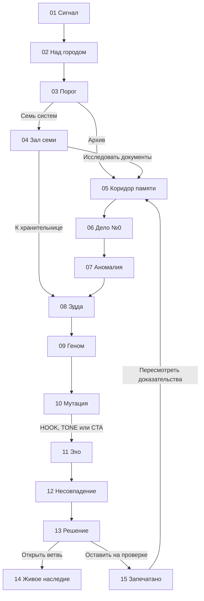
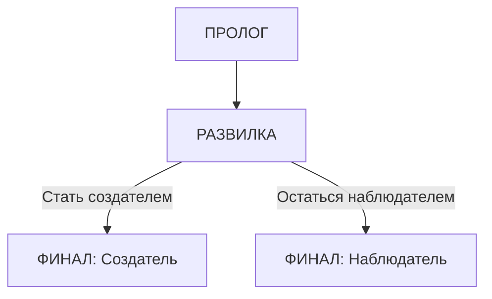

# Явный граф интерактивного фильма

Выбор маршрута меняет состояние истории и показатель маршрута в интерфейсе; тексты Эдды остаются частью фиксированной режиссуры. Выбор одного из трёх генов фиксирует значение `state.gene` и новую формулировку, появляется в «Эхе» и в финале. Открытие ветви не отправляет ничего на настоящий сервер: это художественная развязка, локально записанная в браузере.

## Трёхсценный прототип

Технически финал — **одна сцена** с двумя вариантами локально сформированного статусного сообщения, выбираемыми по `state.route`; фон кадра при этом один и тот же. Итого ровно **3 scene-узла**, из которых один имеет 2 концовки. Прохождение без backend, данные сохраняются только локально.
